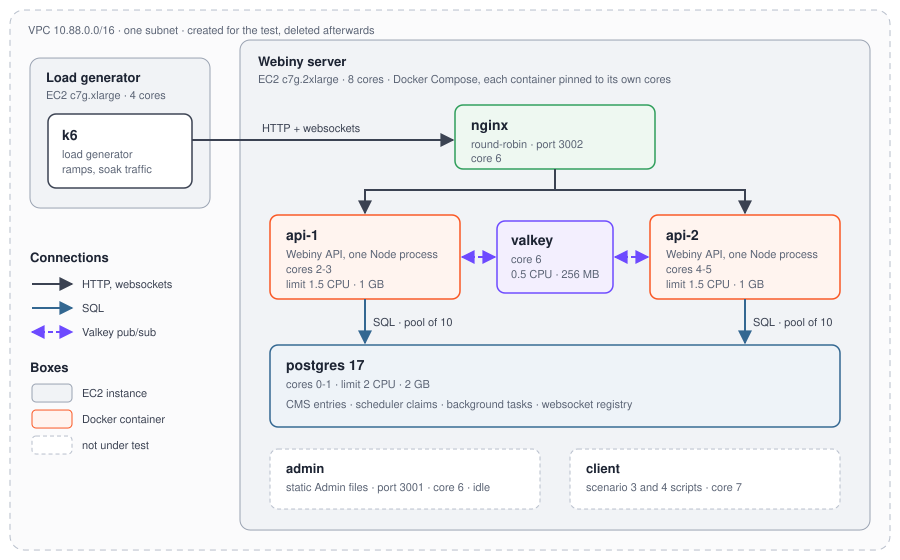

# Webiny standalone under load: results

## TL;DR

- **Setup.** Two copies of the Webiny API (Node.js), sharing one Postgres database, each limited to
  1.5 CPUs and 1 GB, on AWS EC2. The rest of this report calls the two copies "API processes".
- **Capacity.** Together they handle about 160-180 reads/s, 110 writes/s, or 140-180 req/s of
  90/10 mixed traffic with p95 under 1 s.
- **What runs out first.** The API processes' CPU: each read costs 12-14 ms on the Node main
  thread. Postgres is close behind on writes (88-96%) and reaches 99% on mixed traffic.
- **One outage.** 300 scheduled actions due at the same moment get both API processes OOM-killed
  within 2 s (finding 06). With automatic restarts 2.25% of requests failed and every action still
  ran exactly once; without restarts the API stayed down.
- **What held.** Scheduled actions ran exactly once; every background task finished; a SIGTERM under
  load lost 0 of 23,821 requests; all 500 websockets on the stopped process reconnected with no
  message lost; a running bulk task was picked up by the other process; no memory growth in 60
  minutes.
- **Published alpha.** `6.6.0-alpha.10` performs the same as the source build (level or one ramp
  step better).
- **Next.** Findings in `findings/` are issue drafts, none filed. Fix 06 first: it is the only one
  that takes the API down.

## Summary

The highest load each workload took with p95 under 1 s, and what ran out first:

| workload | holds up to | first to saturate | finding |
| --- | --- | --- | --- |
| CMS reads (list + get) | 160-180 req/s | the API processes' Node main thread (~12-14 ms of CPU per read) | - |
| CMS writes (create + update) | 110 req/s | the API processes, with Postgres close behind (88-96%) | 03 |
| 90% reads / 10% writes | 140-180 req/s | the API processes and Postgres together | - |
| 300 scheduled actions due at once | fails at 110 req/s of mixed traffic | memory: both API processes OOM-killed at 1 GB within 2 s of the due time | 06 |

Findings (issue drafts, nothing filed): `findings/`.

| # | finding |
| --- | --- |
| 01 | One extension with a missing license-gated dependency fails every CMS request |
| 02 | The background tasks API checks a permission the Admin never grants |
| 03 | Every CMS write plans a webhook search costing Postgres 5-9 ms, with no webhooks |
| 04 | The websocket registry queries `information_schema` four times on every call |
| 06 | 300 scheduled actions due together get the API processes OOM-killed |
| 07 | CMS bulk actions spend almost all their time in a fixed 120 s wait |
| 09 | `createFolder` ignores the `id` its input documents |

## What was deployed

Two EC2 instances in a VPC of their own:

- **Webiny server** (c7g.2xlarge) runs everything Webiny needs, each part as a Docker container:
  nginx, the two API processes, Postgres and Valkey. They are containers on one instance, not
  instances of their own.
- **Load generator** (c7g.xlarge) runs only k6, the tool that sends the test traffic. It sits on
  its own instance so that generating the load does not take CPU from Webiny.

- **nginx** is the only way in (port 3002) and hands requests to api-1 and api-2 in turn. It is a
  container, not an AWS load balancer.
- **api-1, api-2** run the same Webiny API build, one Node process per container. Standalone
  scales by running more copies of that process. "The Node main thread is full" in this report
  means one of these processes.
- **Postgres** is shared by both processes and holds everything: CMS entries, the scheduler's claims
  (how "exactly once" holds across two processes), background tasks and the websocket registry.
- **Valkey** carries websocket messages from one process to the other: when a request on api-1
  causes an event for a socket open on api-2, api-1 publishes it to Valkey and api-2 sends it.
- Each container is pinned to cores of its own (`compose.ec2.yml`), so they do not take CPU from
  one another. Host load average stayed between 0.9 and 3.9 on 8 cores.

## Method

- **Builds.** webiny-js `6f462b597f` (`next`), built from source, and the published
  `6.6.0-alpha.10` (a `create-webiny-project` project with the `-pg` packages at the same version).
  Both unlicensed. Each has its own database.
- **Data.** Model `loadArticle`, 20 fields, 3,000 published entries (`scripts/seed.mjs`). Every run
  starts from that baseline, restored from a template database (`scripts/reset-db.sh`).
- **Ramps.** A step lasts 60 s; its numbers are from the last 45 s (the first 15 s let the previous
  step's backlog drain). The run stops after the first step with p95 > 1 s or > 1% failed requests,
  where a GraphQL error in a 200 response counts as failed. `scripts/ab.sh` runs the source build
  and the alpha in turn on the same ramp.
- **Pool.** `WEBINY_PG_POOL_MAX` unset: 10 Postgres connections per process.
- **Access.** The load-test API key has `{"name": "tasks"}` added by hand (finding 02); websocket
  clients log in as the admin user, since a socket opened with an API key is registered as
  anonymous.

## Ramps

Last step with p95 under 1 s, and its p95; the next step broke in every run.

| ramp | round | source `6f462b597f` | alpha.10 |
| --- | --- | --- | --- |
| read | 1 | 160 req/s, 122 ms | 180 req/s, 124 ms |
| read | 2 | 180 req/s, 150 ms | 180 req/s, 123 ms |
| read | 3 | 160 req/s, 122 ms | 180 req/s, 123 ms |
| mixed | 1 | 160 req/s, 222 ms | 180 req/s, 160 ms |
| mixed | 2 | 140 req/s, 108 ms | 160 req/s, 142 ms |
| write | 1 | 110 req/s, 183 ms | 110 req/s, 121 ms |

Each build lands within one step of itself across rounds, so these numbers can be compared. No run
stalled below its breaking point: p95 at 40 req/s was 19-49 ms on reads and 25-29 ms on mixed.

- **Read:** 50% `listLoadArticles` (limit 20, filter by category, sometimes rating, one of four
  sorts), 50% `getLoadArticle` by entry id.
- **Write:** 50% `createLoadArticle`, 50% `updateLoadArticle` on a draft the same virtual user
  created.
- **Mixed:** 90% the read mix, 10% the write mix.

At the breaking point both API processes were at 95-100% of one core, which for Node is the main
thread full. API CPU per read (`scripts/cpu-per-req.mjs`): alpha 11.7-13.7 ms, source 11.9-16.5 ms.
In the mixed ramp Postgres reached 99% as well; in the write ramp 88-96%. Per write, Postgres spent
~1.0 ms on the search delete and ~1.7 ms on the search insert.

Run folders: `20261111-173557-read-ramp-source-1` to `20261111-192434-write-ramp-alpha-1`
(names end in `-<build>-<round>`).

## Scheduled actions and background tasks under load

`scripts/scenario3.sh 110 300 200` on alpha.10: mixed traffic at 110 req/s (70% of where mixed
breaks), 300 publishes scheduled for the same moment, and 200 `testingRun` background tasks.

First run (`20261111-193819-scenario3-mixed110`), containers without a restart policy: the kernel
killed both API processes 1-2 s after the due time (`Memory cgroup out of memory: Killed process
... anon-rss:1023804kB`). They stayed down; 19,350 of 38,602 requests got 502 and none of the 300
actions ran.

Second run (`20261111-205110-scenario3-mixed110`), with `restart: unless-stopped` on the API
containers, as a process manager would do in production:

| time (UTC) | |
| --- | --- |
| 20:54:07 | RSS 370 MB (api-1), 359 MB (api-2) |
| 20:54:10.467 | 300 actions due |
| 20:54:11, 20:54:12 | both processes OOM-killed (over 1,024 MB) |
| 20:54:13-14 | both restarted by Docker (api-1's first log line 20:54:13.93); boot recovery starts |
| 20:54:13.7-20:54:22.0 | all 300 run, 155 on api-2 and 145 on api-1, none twice |
| 20:54:22.06 | recovery done: api-1 re-armed 294 actions, api-2 300 |
| 20:54:28 | RSS 307 MB and 308 MB; event-loop lag max under 50 ms |

Both processes re-armed nearly every action; the claims let each run once.

1,337 of 59,305 requests (2.25%) got 502 while the processes were down. All 200 tasks `success`.

The same 300 actions took each process past 1 GB in under 4 s when they fired on time, and cost
almost nothing when boot recovery ran them. So the memory goes into the path that fires due actions
live (finding 06: a worker thread per action), not into the actions. The claims did their job:
exactly once held across two kills and a recovery on both processes.

## Rolling restart at 80 req/s

`20261111-210119-scenario4-mixed80`, alpha.10: mixed traffic at 80 req/s, 1,000 websockets that
reconnect when closed (one broadcast a second), and a bulk Publish of 2,000 drafts running as a
background task. The process holding the task got SIGTERM mid-run and was started again.

- **Requests:** 0 of 23,821 failed (no 502).
- **Websockets:** the 500 sockets on the stopped process closed with 1012 and all reconnected
  (p95 2.3 s); no message was lost. Afterwards all 1,000 sockets sat on the surviving process:
  nothing moves them back, so a rolling restart of both processes leaves them all on the last one
  restarted.
- **Background task:** handed over (`resumed 2`, then `resumed 9`); all 2,000 entries were
  published 2 min 33 s after the SIGTERM. Most of that time is a fixed wait (finding 07).
- **But the surviving process stalled:** p99 3.9 s, max 6.2 s. 500 reconnects at four catalog
  queries each (finding 04) is the likely cause.

## Soak: 60 minutes at 80 req/s

`20261111-194456-soak-mixed80-60min`, alpha.10, mixed traffic at half the mixed breaking point.
287,999 requests, 0 failed; p50 17 ms, p95 44 ms, p99 74 ms, max 198 ms.

| 10 min from | api-1 RSS max | api-2 RSS max | lag p99 max, api-1 / api-2 |
| --- | ---: | ---: | ---: |
| 19:40 | 307 MB | 308 MB | 10.1 / 11.9 ms |
| 20:00 | 312 | 310 | 9.9 / 11.0 |
| 20:20 | 312 | 312 | 10.0 / 11.5 |
| 20:40 | 313 | 312 | 10.0 / 11.5 |

No leak: 6 MB in an hour, heap flat at 66-82 MB.

## Published alpha: 6.6.0-alpha.10

Same stack and limits, its own database and 3,000-entry baseline. In each of the six paired ramps
above, alpha.10 was level with the source build (two) or one ramp step ahead (four), at the same
API CPU per read. Scheduled actions, background tasks, the rolling restart and the soak above all
ran on alpha.10.

## Not done

- Where the 12-14 ms of API CPU per read goes. Reads and mixed traffic break when the Node main
  thread is full, so a CPU profile at ~150 req/s is the next step for the read path.
- Scheduled actions at a lower rate, to find where the due moment stops OOM-killing the processes.
- Websocket fan-out at 1,000 to 5,000 sockets.
- Node's 5 s `keepAliveTimeout` behind a proxy that reuses upstream connections.
- `sharp` is bundled for darwin only (the build ran on macOS); image processing on upload was not
  tested.
